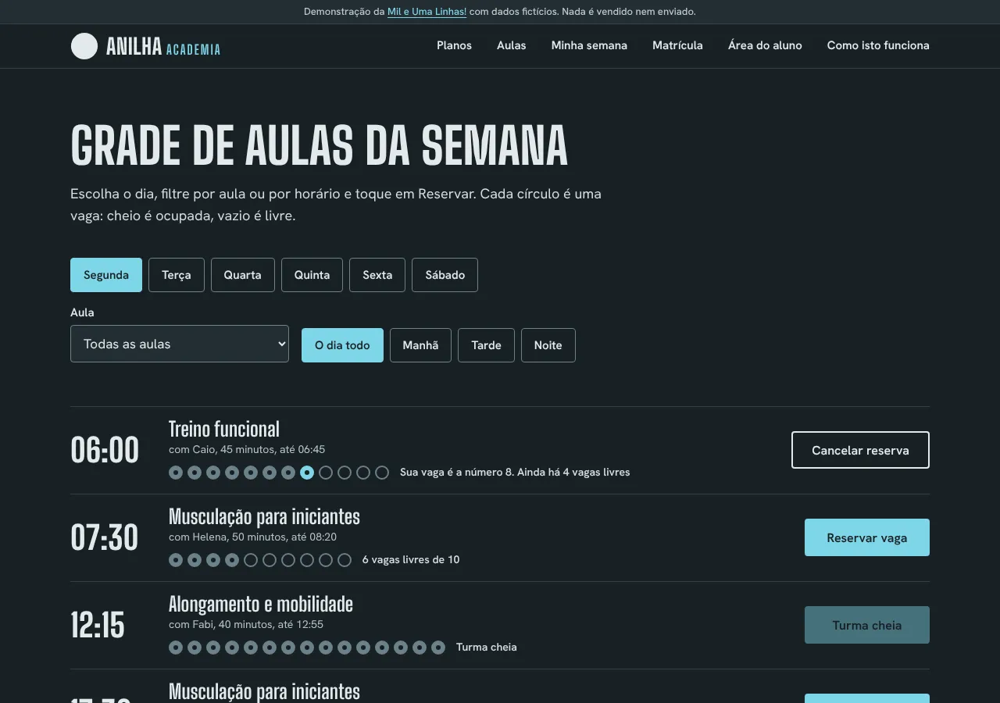
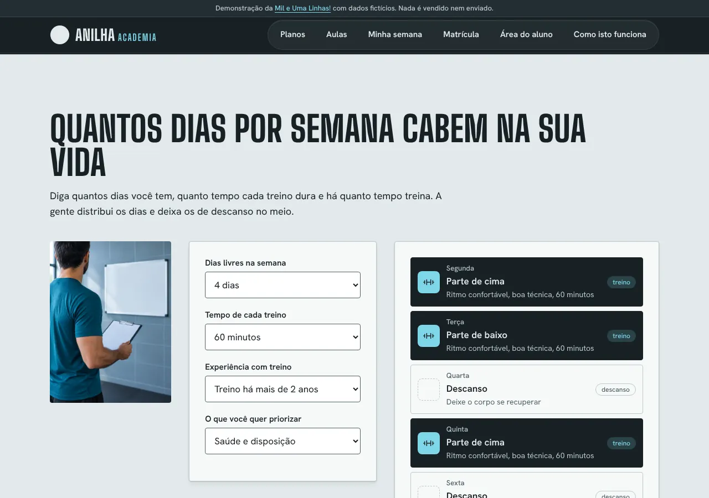
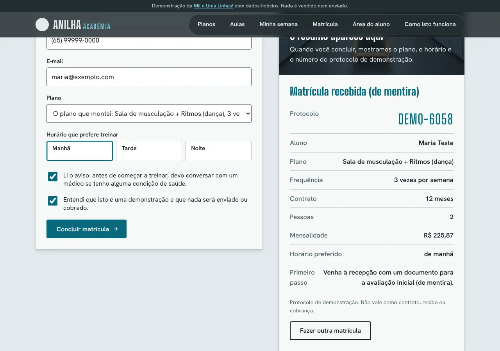
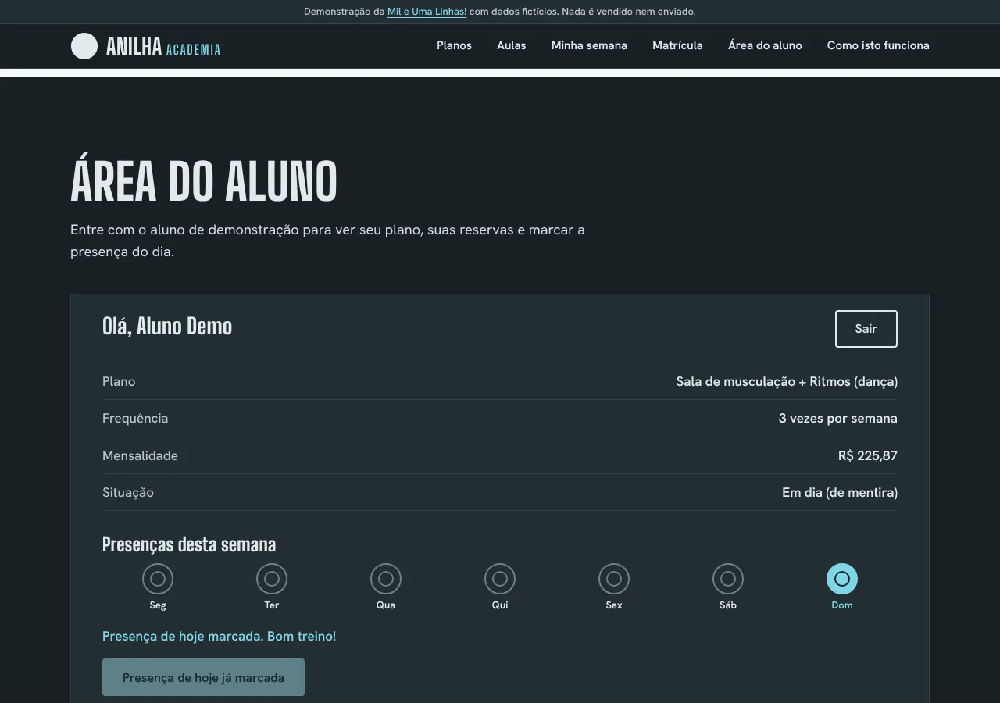
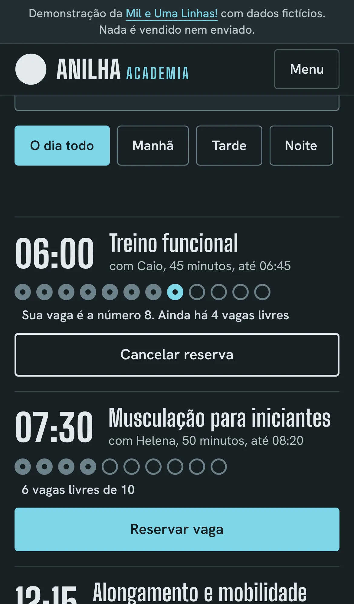

# Anilha Academia

Oi, eu sou o Rodrigo Jr, da [Mil e Uma Linhas!](https://mileumalinhas.com.br). Este é um site de demonstração que eu fiz para mostrar a donos de academia como pode ser um site com cara própria, que não parece modelo pronto.

**Tudo aqui é fictício**: a academia, os instrutores, o endereço, o telefone, os preços, os horários. Nada é vendido, cobrado nem enviado. Os dados que você digitar não saem do seu navegador.


## O que é, para quem não entende de tecnologia

É o site de uma academia de bairro inventada, a Anilha Academia, de Cuiabá. Nele você pode montar um plano e ver quanto custa, reservar vaga numa aula, ver como espalhar os dias de treino na semana, fingir uma matrícula e entrar numa área do aluno de mentira.

## Como usar, em passos

1. Abra o site (ao ser publicado, fica em https://toshiro01001.github.io/academia/).
2. Em **Planos**, marque as modalidades, a frequência, o período e quantas pessoas da casa vão treinar. O preço na placa muda na hora. Toque em "Usar este plano na matrícula" se gostar.
3. Em **Aulas**, escolha o dia, filtre por aula ou por período e toque em "Reservar vaga". Os círculos mostram as vagas. O botão vira "Cancelar reserva".
4. Em **Minha semana**, diga quantos dias tem, o tempo de cada treino e sua experiência. O site distribui os treinos e deixa dias de descanso.
5. Em **Matrícula**, preencha os dados (inventados) e veja o resumo com um protocolo de demonstração.
6. Em **Área do aluno**, entre com `aluno.demo` e `treino-demo` para ver o plano, as reservas e marcar a presença do dia.

| Planos | Aulas |
| --- | --- |
|  |  |

| Minha semana | Matrícula |
| --- | --- |
|  |  |



No celular:

| Abertura | Planos | Aulas |
| --- | --- | --- |
|  |  |  |

## Identidade visual, em resumo

Detalhes em [`docs/identidade.md`](docs/identidade.md).

- **Ideia**: a anilha, o disco de ferro da barra, como unidade de contagem. As vagas de cada aula são fileiras de círculos furados, e o preço do plano sai numa placa numerada, como a de armário.
- **Paleta**: Azulejo `#E3EAEC` (parede de vestiário), Borracha `#182024` (piso), Anilha `#4F6168`, Rejunte `#BCC9CD` e o único destaque, Turquesa `#08687C` (`#7FD6E8` nas faixas escuras). Fugi do preto com neon e do vermelho de academia de propósito.
- **Fontes**: Big Shoulders Display (títulos, números e horários, letra alta de letreiro) e Hanken Grotesk (texto). As duas são locais, licença OFL.
- **Por quê**: academia de bairro é azulejo, borracha e número gravado, não outdoor de suplemento. O site fica sóbrio e o preço e a vaga ficam em destaque.

## Como funciona por dentro

A página carrega uma vez e faz tudo sozinha, sem falar com nenhum servidor. O preço do plano é uma soma com descontos por modalidades, frequência, período e pessoas da casa, calculada em centavos inteiros. A grade de aulas é uma tabela guardada no código; a lotação de cada turma sai de uma conta fixa, não de sorteio. Ao reservar, o site confere se não há choque de horário e se você não passou de 5 reservas. A semana de treino segue regras simples: limite de dias de treino pesado conforme a experiência e pelo menos um dia de descanso. A matrícula valida nome, idade (menores precisam de responsável), WhatsApp com máscara, e-mail e os dois avisos.

## Detalhes técnicos

- HTML, CSS e JavaScript puros. Sem framework, sem CDN, sem analytics.
- Arquivos: `index.html`, `css/estilo.css`, `js/app.js`, `img/hero.webp`, `fonts/`, `404.html`, `robots.txt`, `sitemap.xml`, `docs/`, `tests/site.cjs`.
- CSP restritiva em todas as páginas (`default-src 'self'`, sem inline, sem conexões).
- Acessibilidade: contraste AA, foco visível, teclado, `lang="pt-BR"`, avisos com `aria-live`, respeita `prefers-reduced-motion`.
- `localStorage`: reservas, presenças e resumo do plano. A matrícula não é guardada.
- A foto do hero (`img/hero.webp`, proporção 4:3) é uma foto gerada por IA no Canva (1440x1080), feita a partir do prompt de `docs/identidade.md`.

## Como rodar

```
python3 -m http.server 8319
```

Depois abra http://127.0.0.1:8319/. Não precisa instalar nada.

## Testes

```
node tests/site.cjs
```

Usa o Playwright (instalado à parte) em três tamanhos: 1280x900, iPhone 13 e 320px. Confere erros de console, pedidos para fora do site, rolagem horizontal, texto cortado, fontes, a foto do hero, `prefers-reduced-motion`, a página 404 e cada função (plano, aulas, semana, matrícula e área do aluno). Com `CAPTURAS=1` salva capturas em `docs/`.

## Segurança

Veja [`docs/vistoria.md`](docs/vistoria.md): CSP, nenhum envio de dados, o que fica no `localStorage`, nenhuma dependência e os riscos que sobram.

## Aviso de saúde

A calculadora de semana é só uma ideia de distribuição dos dias. Não é prescrição e não promete resultado. Quem for treinar de verdade deve falar com um profissional de Educação Física e, se tiver alguma condição de saúde, com um médico.

## Quer um site assim?

Fale com a [Mil e Uma Linhas!](https://mileumalinhas.com.br).
